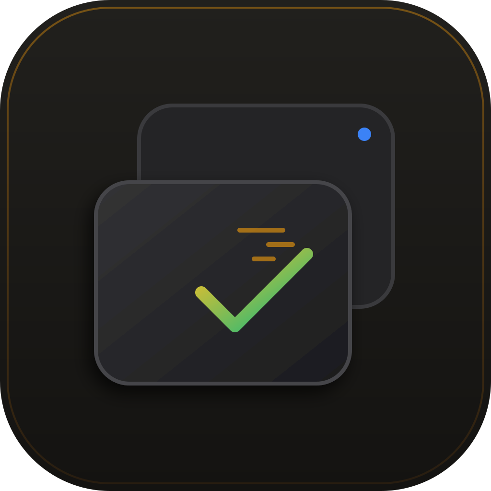
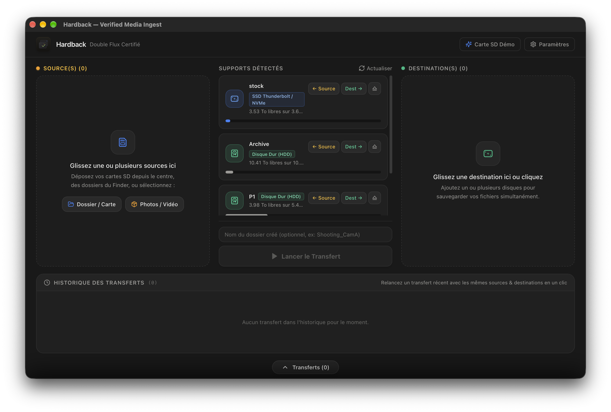
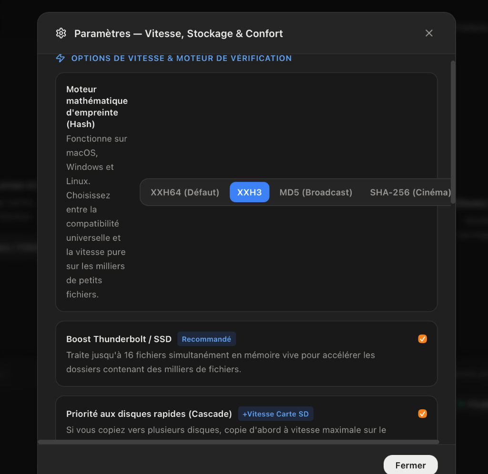

# Hardback — Verified Media Ingest for macOS

<p align="center">
  
</p>

<p align="center">
  <strong>Moteur de Déchargement & Sécurisation de Médias Haute Vitesse avec Vérification Bit-à-Bit</strong>
  <br />
  <em>Conçu pour les DITs, cadreurs, photographes et studios de production sur macOS.</em>
</p>

<p align="center">
  
  
  
  
  
  
</p>

---

## Écosystème Hard Suite (macOS)

**Hardback** fait partie de la **Hard Suite**, une collection d'outils natifs macOS dédiés à la sécurité des flux caméra et au sauvetage de médias professionnels :

| Application | Rôle | Fonctionnalités Clés | Dépôt GitHub |
| :--- | :--- | :--- | :--- |
| **[Hardback](https://github.com/Ward-Milan/hardback)** | **Ingest & Prévention (Tournage)** | Déchargement multi-destinations en cascade, vérification physique `F_NOCACHE` bit-à-bit (XXH64, XXH3, SHA-256), manifestes ASC-MHL & compagnon barre des menus. | [Ward-Milan/hardback](https://github.com/Ward-Milan/hardback) |
| **[HardRecover](https://github.com/Ward-Milan/hardrecover)** | **Sauvetage & Réparation (Urgence)** | Récupération de cartes formatées (ExFAT/Carving), reconstruction d'entêtes vidéo/audio tronqués sans ré-encodage, clonage 5 passes `.img` et diagnostic S.M.A.R.T. | [Ward-Milan/hardrecover](https://github.com/Ward-Milan/hardrecover) |

---

## Téléchargement Direct (DMG)

Le package d'installation autonome macOS (Apple Silicon) est prêt à l'emploi :

<p align="center">
  <a href="https://github.com/Ward-Milan/hardback/releases/latest/download/Hardback_0.1.0.dmg">
    
  </a>
</p>

### Installation sur macOS
1. Téléchargez et ouvrez **[`Hardback_0.1.0.dmg`](https://github.com/Ward-Milan/hardback/releases/latest/download/Hardback_0.1.0.dmg)** (ou directement depuis le dépôt : [Hardback_0.1.0.dmg](Hardback_0.1.0.dmg)).
2. Glissez-déposez **Hardback.app** dans votre dossier **/Applications**.
3. *Note de sécurité macOS* : S'agissant d'un binaire open-source distribué sans signature payante Apple Developer, faites **Clic droit > Ouvrir** au premier lancement (ou autorisez l'application dans *Réglages Système > Confidentialité et sécurité > Ouvrir quand même*).

---

## Conçu en Vibe Coding

Hardback est développé en **Vibe Coding** avec **Google Antigravity** en pair-programming assisté par IA.

Du pipeline asynchrone non mis en cache (`F_NOCACHE` POSIX natif en Rust), au lissage dynamique de bande passante sur cartes SD, jusqu'au cycle de vie en arrière-plan natif macOS (menulet autonome dans la barre des menus et fermeture de fenêtre sans coupure de transfert), l'ensemble du projet a été conçu et optimisé pour répondre aux contraintes de tournage.

---

## Aperçu de l'Interface

### 1. Studio Principal — Vue 3 Colonnes & Tiroir d'Historique
Organisation en 3 sections : **Sources**, **Périphériques Détectés**, et **Destinations**, avec historique des sessions et télémétrie en temps réel.



### 2. Hardback Express — Compagnon Barre des Menus macOS
Interface rapide accessible depuis la barre des menus macOS pour suivre les transferts actifs et éjecter les supports sans encombrer l'écran.



---

## Fonctionnalités Techniques

### 1. Vérification Physique Bit-à-Bit (`F_NOCACHE`)
* **Contournement du cache RAM** : Application du flag système `fcntl(fd, F_NOCACHE, 1)` lors de la relecture de vérification afin de contrôler les cellules physiques réelles du support de destination.

### 2. Double Flux Cascade (Single-Read Multi-Write)
* **Lecture unique de la source** : La carte mémoire n'est lue qu'une seule fois dans un tampon mémoire partagé et répliquée simultanément vers toutes les destinations sélectionnées.

### 3. Multi-Moteur de Hashage Certifié
* **XXH64 & XXH3 (SIMD NEON)** : Standards haute vitesse de l'industrie cinématographique et des manifestes `.mhl` (ASC-MHL).
* **MD5 & SHA-256** : Standards contractuels Broadcast et archives haute sécurité.

### 4. Compagnon Barre des Menus & File d'Attente HDD
* **Exécution continue en arrière-plan** : Fermer la fenêtre principale masque l'interface sans interrompre les copies en cours.
* **Smart Queue HDD** : Ordonnancement intelligent sur disques mécaniques pour éviter la fragmentation des lectures/écritures (*I/O thrashing*).
* **Contrôle d'intégrité vidéo & Rapports** : Vérification structurelle des conteneurs `.MOV`, `.MP4`, `.MXF` et génération automatique des manifestes **ASC-MHL** et rapports **PDF**.

---

## Architecture du Projet

```text
Hardback/
├── assets/
│   └── screenshots/          # Captures d'écran de l'interface
├── src/                      # Interface Utilisateur (React 18 + TypeScript + Tailwind CSS)
│   ├── App.tsx               # Studio principal (3 colonnes, tiroir, réglages)
│   ├── Menulet.tsx           # Vue popover pour la barre des menus macOS
│   ├── Logo.tsx              # Identité visuelle vectorielle Hardback
│   ├── types.ts              # Modèles de données TypeScript
│   ├── styles.css            # Thème sombre macOS (#191919)
│   └── main.tsx              # Point d'entrée React
├── src-tauri/                # Moteur Natif Rust (Tauri v2)
│   ├── Cargo.toml            # Dépendances Rust (xxhash, sha2, md-5, tokio, tauri)
│   ├── tauri.conf.json       # Configuration Tauri v2 et TrayIcon
│   └── src/
│       ├── engine.rs         # Pipeline E/S asynchrone, F_NOCACHE, streaming hasher
│       ├── volumes.rs        # Détection matérielle macOS (IOKit/diskutil) & éjection
│       ├── report.rs         # Générateur de rapports ASC-MHL, CSV, TXT et PDF
│       ├── settings.rs       # Préférences de l'application
│       ├── history.rs        # Historique persistant des transferts
│       ├── updater.rs        # Mise à jour intégrée depuis GitHub Releases
│       └── lib.rs            # Commandes IPC Tauri et cycle de vie
├── app-icon.svg              # Icône vectorielle haute définition (1024×1024)
├── Hardback_0.1.0.dmg        # Installateur autonome macOS
├── LICENSE                   # Licence Open-Source MIT
└── README.md                 # Documentation du projet
```

---

## Compilation & Développement Local

### Prérequis
* **macOS** 11.0 (Big Sur) ou supérieur
* **Node.js** >= 20 & **npm**
* **Rust** (toolchain stable `cargo` >= 1.77)

### Installation et lancement
```bash
git clone https://github.com/Ward-Milan/hardback.git
cd hardback
npm install
npm run tauri dev
```

### Générer le package d'installation (.dmg)
```bash
npm run tauri build -- --bundles dmg --no-sign
```

---

## Licence

Distribué sous licence open-source **MIT**. Consultez le fichier [LICENSE](LICENSE) pour plus d'informations.
