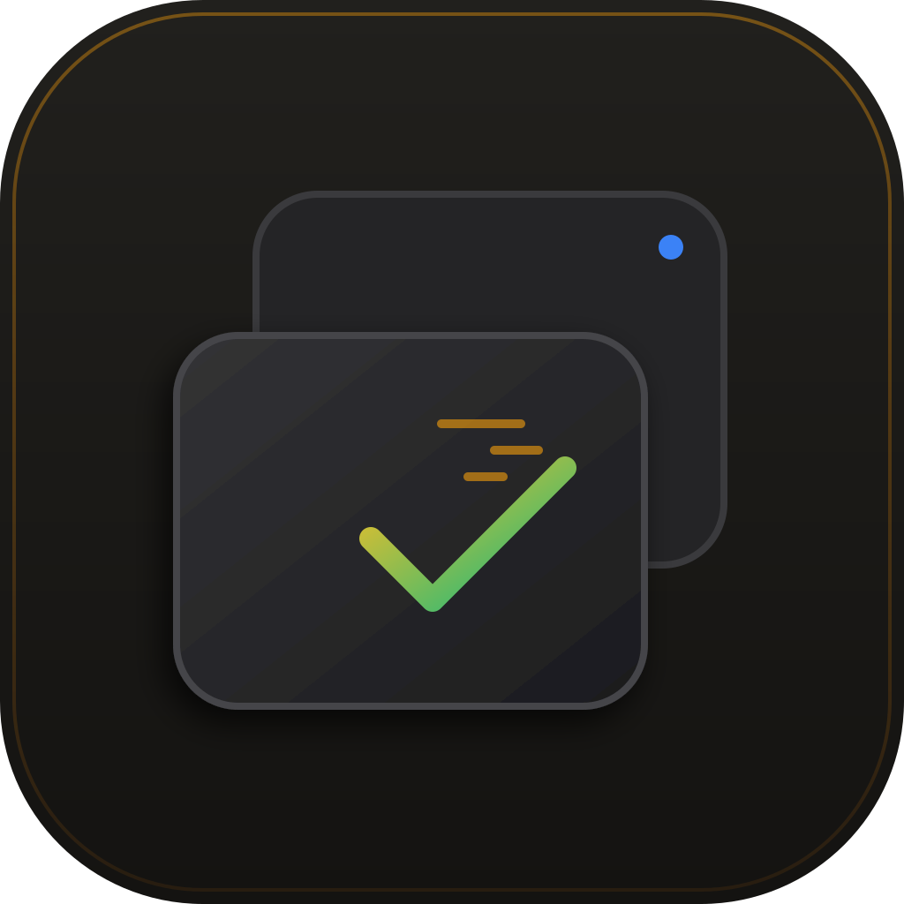
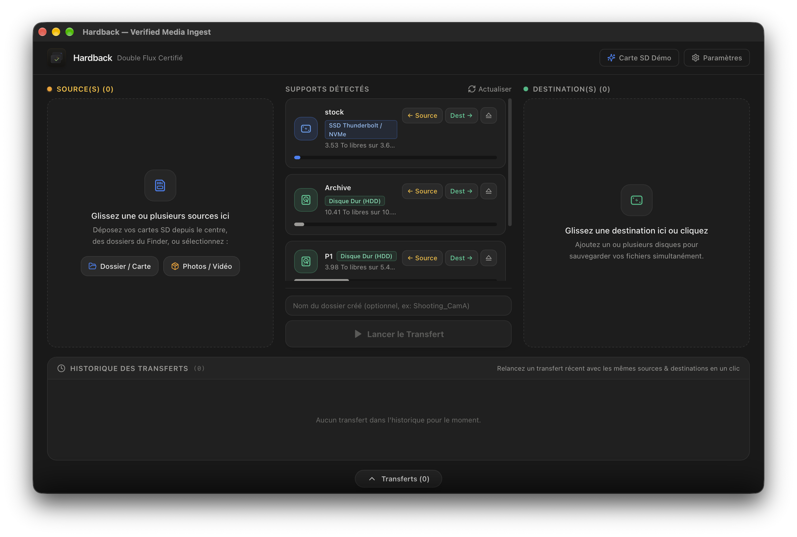
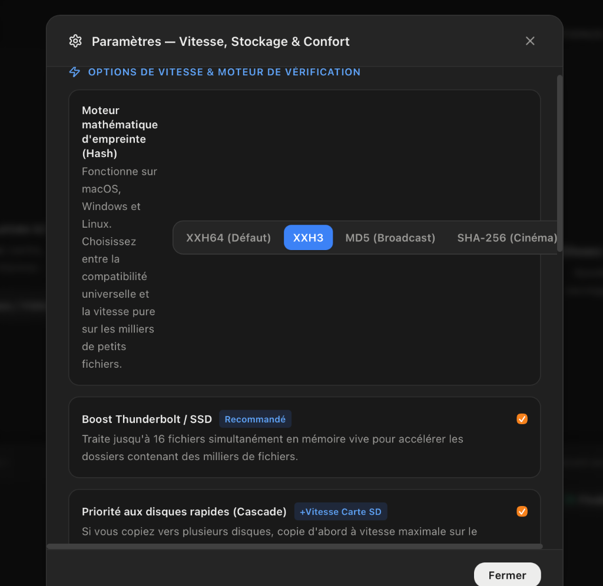

# Hardback — Verified Media Ingest for macOS

<p align="center">
  
</p>

<p align="center">
  <strong>Moteur de Déchargement & Sécurisation de Médias Haute Vitesse avec Vérification Bit-à-Bit</strong>
  <br />
  <em>Conçu pour les DITs, cadreurs, photographes et créateurs de contenu sur macOS.</em>
</p>

<p align="center">
  
  
  
  
  
  
</p>

---

## 📥 Téléchargement Direct (DMG)

Le package d'installation autonome macOS est prêt à l'emploi :

<p align="center">
  <a href="https://github.com/Ward-Milan/hardback/releases/latest/download/Hardback_0.1.0.dmg">
    
  </a>
</p>

### Installation sur macOS :
1. Téléchargez et ouvrez **[`Hardback_0.1.0.dmg`](https://github.com/Ward-Milan/hardback/releases/latest/download/Hardback_0.1.0.dmg)** (ou directement depuis le dépôt : [Hardback_0.1.0.dmg](Hardback_0.1.0.dmg)).
2. Glissez-déposez **Hardback.app** dans votre dossier **/Applications**.
3. *Note de sécurité macOS* : Comme il s'agit d'une version open-source compilée directement sans certificat payant Apple Developer, au premier lancement, faites **Clic droit > Ouvrir** (ou autorisez dans *Réglages Système > Confidentialité et sécurité > Ouvrir quand même*).

---

## ✨ Conçu en Vibe Coding

Hardback est une application fièrement développée en **Vibe Coding** avec **Google Antigravity** en pair-programming assisté par IA.

De la conception du pipeline asynchrone non mis en cache (`F_NOCACHE` POSIX natif en Rust), au contournement des limitations de bande passante sur cartes SD par lissage dynamique, en passant par le cycle de vie hybride inspiré de CleanMyMac (menulet autonome en tâche de fond + fermeture de fenêtre sans coupure de transfert), l'ensemble du projet a été itéré, débogué et optimisé en temps réel avec des exigences de niveau cinéma.

---

## 📸 Aperçu de l'Interface

### 1. Le Studio Principal (Vue 3 Colonnes & Tiroir d'Historique)
Organisation claire en 3 sections : **Source (Ambre)**, **Périphériques Détectés**, et **Destinations (Émeraude)**, avec historique des sessions et tiroir de télémétrie en bas de page.



### 2. Hardback Express (Pop-up barre des menus macOS)
Mini-application compagnon ultra-légère accessible depuis la barre des menus macOS pour décharger rapidement une carte SD sans encombrer l'écran.



---

## ⚡ Fonctionnalités Clés

### 🔒 Vérification Physique Bit-à-Bit Directe (`F_NOCACHE`)
* **Contournement du cache RAM** : Sur macOS, le moteur applique l'indicateur système `fcntl(fd, F_NOCACHE, 1)` lors de la relecture de vérification. Cela force le système à relire les cellules physiques réelles de la mémoire flash (SSD, carte SD), garantissant une certification mathématique zéro corruption.

### 🌊 Double Flux Cascade (Single-Read Multi-Write)
* **Lecture unique de la carte source** : La carte SD ou le support caméra n'est lu qu'une seule fois dans un tampon mémoire partagé.
* **Écriture miroir simultanée** : Les blocs de données sont répliqués en parallèle vers toutes les destinations sélectionnées (ex: un SSD NVMe de travail + deux disques durs d'archivage).
* Réduit considérablement l'usure thermique des cartes mémoire et divise par 2 ou 3 le temps d'ingestion global.

### 🛡️ Multi-Moteur de Hashage Certifié
* **XXH64** : Standard cinéma universel compatible avec Silverstack, DaVinci Resolve Studio et les fichiers `.mhl`.
* **XXH3** : Hash ultra-véloce avec accélération vectorielle SIMD (Apple Silicon NEON).
* **MD5** : Standard contractuel requis pour les flux Broadcast & chaînes TV.
* **SHA-256** : Standard cryptographique haute sécurité pour les archives gouvernementales et patrimoniales.

### 🟢 Cycle de Vie CleanMyMac (Barre des Menus)
* **Mode arrière-plan discret** : Fermer la fenêtre principale via la croix rouge `(X)` masque la fenêtre mais ne quitte **jamais** l'application ni ne coupe les transferts.
* **Hardback Express** : Une icône dans la barre des menus permet de suivre l'avancement, suspendre ou annuler un transfert, et assigner rapidement les cartes SD branchées.
* **Boutons d'éjection intégrés** : Éjection sécurisée (`⏏`) en 1 clic des périphériques externes directement depuis le menu rapide.
* Pour quitter complètement l'application : **Clic droit sur l'icône de la barre des menus > Quitter Hardback**.

### 🚥 File d'Attente Intelligente pour Disques Durs (Smart Queue HDD)
* Détecte si un disque est un disque mécanique (HDD).
* Si un transfert est déjà en cours sur un HDD, les nouveaux transferts sur ce même disque sont placés en file d'attente (`queued`) pour éviter les conflits mécaniques de têtes de lecture (*I/O thrashing*).

### 🎬 Contrôle d'Intégrité Vidéo (Video Health Check)
* Analyse à la volée des conteneurs vidéo QuickTime (`.MOV`), MP4 (`.MP4`) et MXF (`.MXF`).
* Détecte immédiatement les fichiers tronqués ou privés de leur atome `moov` (coupure de batterie caméra en plein tournage, carte retirée trop tôt) et alerte l'équipe avant tout formatage.

### 📜 Certificats & Rapports
* Export automatique des manifestes **ASC-MHL v2 (XML)** et MHL classique.
* Export de rapports complets au format **PDF** avec tableau d'intégrité, horodatages et signatures de vérification.

---

## 🏗️ Architecture du Projet

```text
Hardback/
├── assets/
│   └── screenshots/          # Captures d'écran pour la documentation
├── src/                      # Interface Utilisateur (React 18 + TypeScript + Tailwind CSS)
│   ├── App.tsx               # Studio principal (3 colonnes, tiroir, réglages, modales)
│   ├── Menulet.tsx           # Vue popover pour la barre des menus macOS
│   ├── Logo.tsx              # Composant vectoriel SVG officiel (Double Flux Cascade)
│   ├── types.ts              # Typages TypeScript des données, jobs et périphériques
│   ├── styles.css            # Styles globaux & animations
│   └── main.tsx              # Point d'entrée React et routage de fenêtre
├── src-tauri/                # Moteur Natif Rust (Tauri v2)
│   ├── Cargo.toml            # Dépendances Rust (xxhash, sha2, md-5, tokio, tauri)
│   ├── tauri.conf.json       # Configuration des fenêtres, barre de menu et thème sombre
│   └── src/
│       ├── engine.rs         # Pipeline asynchrone E/S, F_NOCACHE, streaming hasher, delta resume
│       ├── volumes.rs        # Détection matérielle macOS (IOKit/diskutil), éjection propre
│       ├── report.rs         # Générateur de rapports ASC-MHL, CSV, TXT et PDF natif
│       ├── settings.rs       # Préférences de l'application (~/.hardback/settings.json)
│       ├── history.rs        # Historique persistant des transferts
│       └── lib.rs            # Commandes IPC Tauri, TrayIcon macOS et cycle de vie
├── app-icon.svg              # Icône vectorielle source haute définition (1024×1024)
├── Hardback_0.1.0.dmg        # Installateur autonome macOS
├── LICENSE                   # Licence Open-Source MIT
└── README.md                 # Documentation GitHub du projet
```

---

## 🛠️ Compilation & Développement Local

### Prérequis
* **macOS** 11.0 (Big Sur) ou supérieur
* **Node.js** >= 20 & **npm**
* **Rust** (toolchain stable avec `cargo` >= 1.77) :
  ```bash
  curl --proto '=https' --tlsv1.2 -sSf https://sh.rustup.rs | sh
  ```

### Cloner et installer les dépendances
```bash
git clone https://github.com/Ward-Milan/hardback.git
cd hardback
npm install
```

### Lancer en mode développement
```bash
npm run tauri dev
```

### Compiler le binaire release et générer le DMG
```bash
npm run tauri build -- --bundles dmg --no-sign
```
Le fichier `.dmg` est généré dans `src-tauri/target/release/bundle/dmg/`.

---

## 📄 Licence

Distribué sous licence open-source **MIT**. Consultez le fichier [LICENSE](LICENSE) pour plus de détails.

---

<p align="center">
  Développé avec passion pour la communauté du cinéma et de la vidéo.
</p>

Distribué sous licence open-source **MIT**. Consultez le fichier [LICENSE](LICENSE) pour plus de détails.

---

<p align="center">
  Développé avec passion pour la communauté du cinéma et de la vidéo.
</p>

